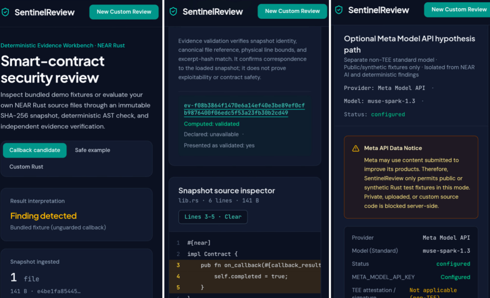
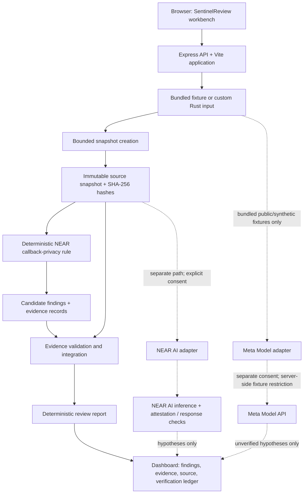
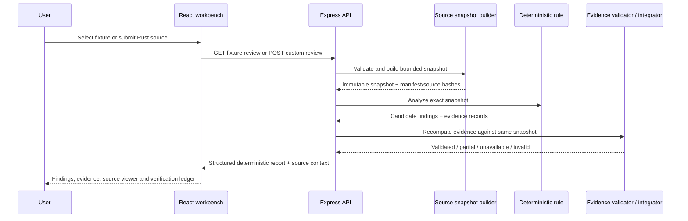
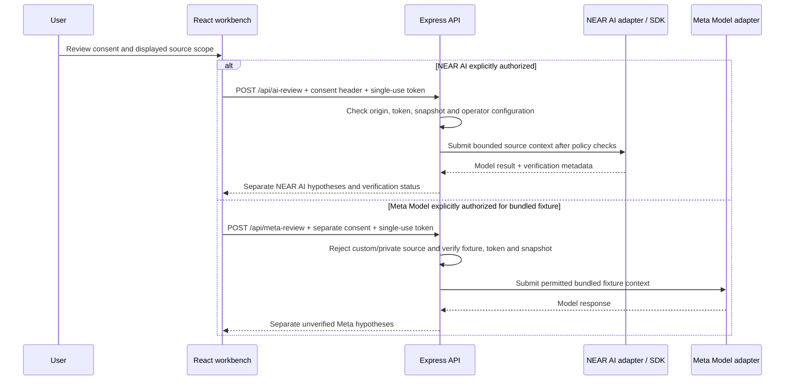

# SentinelReview

<p align="center">
  <strong>NEAR Rust Smart-Contract Review Workbench</strong><br>
  Deterministic source analysis · Reproducible evidence · Consent-gated AI hypotheses
</p>

<p align="center">
  
</p>

<p align="center">
  <a href="https://github.com/chokri29/SentinelReview/actions/workflows/ci.yml">
    
  </a>
  <a href="#running-locally">
    
  </a>
  <a href="https://nodejs.org/en/download/" title="Download Node.js">
    
  </a>
</p>

> **Scope:** SentinelReview is an experimental review workbench that supports security investigation and human review. It is not a complete security audit, an exploitability oracle, or a smart-contract safety certification.

## What SentinelReview does

Smart-contract reviewers need more than an AI-generated explanation: they need to know which exact source was analyzed, which deterministic checks ran, and whether the evidence shown in a report can be recomputed against that source.

SentinelReview combines a bounded Rust source-ingestion pipeline, a narrow deterministic NEAR callback-privacy rule, source-linked evidence validation, and two optional AI hypothesis providers. Its central principle is:

**AI proposes hypotheses → deterministic checks and evidence recomputation decide what is reproducible → human reviewers interpret the result.**

The deterministic pipeline runs independently of AI providers. NEAR AI and Meta Model API are separate, optional paths; neither can turn an AI hypothesis into a deterministic finding.

## At a glance

| Capability | What it does | Important boundary |
|---|---|---|
| Rust source input | Reviews bundled fixtures or user-supplied Rust `.rs` files through the workbench | Custom source is sent to the SentinelReview application backend for deterministic processing; it is not processed solely in the browser |
| Bounded source snapshot | Validates canonical paths, UTF-8, file counts and byte limits; creates an immutable snapshot | A source hash identifies the analyzed bytes; it does not prove authorship or provenance |
| Deterministic NEAR rule | Detects a narrowly scoped callback-result privacy pattern | Not a general Rust analyzer or complete vulnerability scanner |
| Evidence validation | Recomputes source/manifest identity, file references, line bounds and excerpt-hash correspondence | Evidence correspondence does not prove exploitability or source safety |
| NEAR AI | Optional, explicit-consent hypothesis analysis with SDK-backed attestation and response-verification checks | Source is transmitted to the configured NEAR AI service after authorization; verification does not prove the model's conclusions are correct |
| Meta Model API | Optional, separately consented hypothesis analysis for bundled public/synthetic fixtures only | Custom or private source is rejected server-side; this provider path is not TEE-attested and its output is not cryptographically verified |
| Verification ledger and source viewer | Shows pipeline stages, findings, evidence status, source excerpts and verification metadata | A successful individual check must not be interpreted as a complete audit pass |

## Current application architecture

The current product is the Express + Vite + React workbench. The older standalone `dashboard/` application and its port-4173 demo workflow are not the current application entry point.

### System overview



The dotted paths are optional and separate from deterministic findings. The NEAR AI and Meta Model API integrations have different trust properties and must not be presented as equivalent verification mechanisms.

### Deterministic review sequence



### Optional AI paths



## Deterministic engine and evidence model

### Source ingestion and reproducibility

The source loader accepts Rust `.rs` files and applies bounded traversal and snapshot rules. The custom-source path applies matching limits before the server builds the snapshot.

| Limit | Default |
|---|---:|
| Rust source files | 200 |
| Bytes per file | 1 MiB |
| Total source bytes | 5 MiB |
| Encoding | Strict UTF-8 validation |
| Paths | Canonical relative POSIX paths; traversal and unsafe path forms rejected |
| Snapshot | Immutable after creation |

The manifest and source fingerprints use SHA-256 with domain-separated hashing and canonical file ordering. Hashes make it possible to compare source identity; they are not encryption, proof of authorship, or independent provenance.

### Current deterministic rule

| Field | Current behavior |
|---|---|
| Rule ID | `NEAR-RUST-CALLBACK-PRIVATE-001` |
| Focus | NEAR Rust methods that accept `#[callback_result]` |
| Review question | Is the callback-result handler protected by a recognized `#[private]` attribute or narrowly supported direct predecessor/current-account guard? |
| Output | A review candidate with source-linked evidence and a severity/status |
| Limitation | A recognized manual guard may be marked inconclusive; this rule does not prove the guard's complete effectiveness |

The rule is intentionally narrow. It may miss indirect or alternative authorization logic, other vulnerability classes, unsafe cross-contract behavior, dependency risks, and issues outside the inspected Rust source.

### Evidence verification terminology

| Status / label | Meaning | Does not mean |
|---|---|---|
| `validated` | Evidence passed the validator's applicable schema, snapshot, path, line-range and hash checks | The finding is exploitable or the contract is unsafe |
| `partial` | Some evidence properties could not be established, such as when an optional excerpt hash is absent | A complete evidence verification |
| `unavailable` | Required source or evidence context was unavailable | A successful check |
| `invalid` | A validation check failed | A harmless warning that can be silently ignored |
| Evidence matched | The evidence reference corresponds to the loaded snapshot under the validator's checks | Independent source provenance or vulnerability confirmation |
| No candidate detected | The selected rule emitted no candidate for this input | The contract is safe or vulnerability-free |

The validator checks the evidence schema, snapshot and manifest structure, canonical paths and ordering, snapshot/manifest file consistency, file hashes and metadata, manifest/source hashes, evidence source hash, unique file references, line bounds and any supplied excerpt hash. The evidence integrator resolves finding references and reports incomplete or invalid integration rather than silently upgrading a status.

## AI provider boundaries

### NEAR AI — optional, attestation-gated hypothesis analysis

NEAR AI is integrated through the server-side `@nearai/inference-sdk` adapter. The configured model is fixed in code to `z-ai/glm-5.3-flash`; the browser cannot select a model or supply operator-approved measurements.

The NEAR AI action is inactive until the user explicitly authorizes the displayed source snapshot. The server additionally checks same-origin policy, a consent header, a short-lived single-use token bound to the source snapshot and model configuration, and the required server-side credentials and operator-approved measurements.

The adapter requires the configured attestation and deployment policy checks, including current TCB status, required GPU evidence, verified deployment provenance, matching operator-approved Compose and OS-image measurements, and a verified provider-TEE response signature associated with the approved model-attestation evidence. Failed or unavailable verification must remain visible and must not be treated as success.

| NEAR AI setting | Purpose |
|---|---|
| `NEARAI_API_KEY` | Server-side API credential |
| `NEARAI_OPERATOR_APPROVED_COMPOSE_HASH` | Operator-approved Compose measurement |
| `NEARAI_OPERATOR_APPROVED_OS_IMAGE_HASH` | Operator-approved OS image measurement |
| Model | Fixed in adapter: `z-ai/glm-5.3-flash` |
| SDK | `@nearai/inference-sdk` pinned to `0.3.0` |

The application can transmit the full loaded Rust source snapshot and deterministic-finding metadata to NEAR AI after explicit consent and policy checks. The adapter rejects source context above 256 KiB or a serialized prompt above 320 KiB rather than truncating it. E2EE and attestation are not a promise that the model does not process the submitted source. They also do not prove AI conclusions are correct, complete, or independently approved by NEAR.

### Meta Model API — fixture-only, unverified hypotheses

Meta Model API is a separate optional provider using the Standard model `muse-spark-1.3`. It is not part of NEAR AI attestation and does not provide the provider-TEE response verification used by the NEAR path.

**Free-credit data-use notice:** Meta's dashboard warns that content submitted while free credits are active may be used for product improvement. SentinelReview therefore restricts this integration to bundled public or synthetic Rust test fixtures. Private, uploaded, or custom Rust source is rejected server-side and is not sent through this provider path.

The Meta path requires its own explicit consent action and a short-lived, single-use token bound to the selected fixture snapshot and Meta configuration. The server independently enforces the fixture-only restriction; hiding or disabling a UI control is not the security boundary.

| Meta setting | Purpose |
|---|---|
| `META_MODEL_API_KEY` | Server-side Meta API credential; never expose it in browser code or commit it |
| Provider | Meta Model API |
| Model | Fixed in adapter: `muse-spark-1.3` (Standard) |
| Allowed input | Bundled public/synthetic fixtures only |
| Custom/private source | Rejected server-side |
| Result status | Unverified AI hypotheses; no TEE attestation or cryptographic response signature |

Meta hypotheses are displayed separately. They do not modify deterministic findings, establish exploitability, or become verified findings merely because the API returns a response. Review the provider's current data-use terms before enabling free-credit use.

## API surface

| Method | Endpoint | Purpose | Important behavior |
|---|---|---|---|
| `GET` | `/api/health` | Backend health check | Returns a small JSON health response |
| `GET` | `/api/review` | Deterministic review of the default bundled fixture | Returns the structured report, snapshot files, hashes and provider configuration status |
| `GET` | `/api/review?fixture=triggering` | Deterministic review of callback candidate fixture | No AI provider request is made |
| `GET` | `/api/review?fixture=safe` | Deterministic review of safe example fixture | No AI provider request is made |
| `POST` | `/api/review/custom` | Submit bounded custom Rust source for deterministic review | JSON request; custom source is processed by the application backend; no AI provider is contacted in this step |
| `POST` | `/api/ai-review` | Optional NEAR AI hypothesis analysis | Same-origin checks, explicit consent header and single-use snapshot-bound token required |
| `POST` | `/api/meta-review` | Optional Meta hypothesis analysis | Separate consent and token; server rejects custom/private source and permits bundled fixtures only |

API responses use no-store behavior and security-related response headers. The frontend uses a guarded JSON response parser so HTML or malformed responses are surfaced as endpoint/status/content-type errors rather than misleading JSON parse failures.

## Running locally

### Requirements

- Node.js **24.22.1 or newer** (as declared in `package.json`).
- npm, included with Node.js.
- Git.

Check versions:

```bash
node --version
npm --version
```

### Install and start the workbench

```bash
git clone https://github.com/chokri29/SentinelReview.git
cd SentinelReview
npm ci
npm run dev
```

Open the local URL shown by the development server. The Express application listens on `0.0.0.0:3000` by default; the Vite development middleware serves the React workbench through the application server.

For a production-style start, build first and then start the server:

```bash
npm run build
npm start
```

The server uses port `3000` by default. Set `PORT` in the environment to override it.

### Available commands

| Command | Purpose |
|---|---|
| `npm ci` | Install the exact dependency tree from `package-lock.json` |
| `npm run dev` | Start the Express + Vite development workbench |
| `npm run typecheck` | Run TypeScript checks (`tsc --noEmit`) |
| `npm test` | Run the Vitest suite |
| `npm run build` | Build the production frontend bundle into `dist/` |
| `npm start` | Start the production Express server |
| `npm run diagnose:nearai-model` | Run the NEAR model-metadata diagnostic; this is not a live inference review |

### Verification / CI

The GitHub Actions workflow on `main` runs the Node.js 24 environment and executes:

1. `npm ci`
2. `npm run typecheck`
3. `npm test`
4. `npm run build`

The automated tests use mocks and fixtures for provider adapter and API policy behavior. Passing tests do not establish that external provider credentials, live inference, live attestation, or a deployed AI Studio environment are operational. Do not describe a live provider test as successful unless it has actually been run and observed.

## Repository layout

| Path | Responsibility |
|---|---|
| `server.ts` | Express application, API routes, consent/token enforcement, proxy-aware same-origin validation and static production serving |
| `src/App.tsx` | Main React workbench and request orchestration |
| `src/components/` | Dashboard panels for source input, pipeline, findings, evidence, source viewer, verification ledger and AI providers |
| `src/contracts/v1.ts` | Versioned Zod schemas and shared contracts |
| `src/source/load-source.ts` | Bounded Rust source loading and immutable snapshots |
| `src/source/custom-snapshot.ts` | Validates and constructs snapshots from submitted custom source |
| `src/source/manifest-hash.ts` | Domain-separated SHA-256 manifest/source hashing |
| `src/source/validate-evidence.ts` | Deterministic evidence integrity validation |
| `src/source/integrate-evidence.ts` | Evidence validation, duplicate detection and finding-reference resolution |
| `src/rules/parse-rust.ts` | Rust syntax parsing support |
| `src/rules/near-rust-callback-private.ts` | Narrow NEAR callback-result privacy rule |
| `src/demo/deterministic-review.ts` | Builds the deterministic review report |
| `src/ai/near-ai-adapter.ts` | NEAR AI inference and attestation/response-verification policy boundary |
| `src/ai/meta-model-adapter.ts` | Fixture-only Meta Model API hypothesis adapter |
| `demo-fixtures/` | Bundled triggering and safe Rust fixtures |
| `tests/` | Contract, source, rule, adapter, UI and API regression tests |
| `.github/workflows/ci.yml` | GitHub Actions CI workflow |

## Security and responsible-use notes

- Treat submitted source code as sensitive. Custom source is transmitted to the SentinelReview backend for deterministic processing.
- Do not submit secrets, credentials, private keys, or source you are not authorized to share.
- NEAR AI transmission is a separate action requiring explicit consent and successful server-side policy checks.
- Meta Model API is restricted to bundled public/synthetic fixtures; custom/private source is blocked server-side.
- Keep all API keys in server-side environment secrets. Never put keys in React code, browser storage, committed files, screenshots, or public issue reports.
- AI-generated content is a hypothesis, not a verified vulnerability. Human review and independent testing remain necessary.
- A matching source hash is not encryption, provenance, authorship, or proof that the source is safe.
- Missing, failed, unavailable, inconclusive, partial and not-run statuses must remain visible; never silently convert them into passing states.
- Do not claim complete audit coverage, absolute confidentiality, independent NEAR approval, or guaranteed vulnerability detection.

## Project status

SentinelReview is an evolving NEAR-focused review prototype. The current workbench combines deterministic-first source review and evidence verification with separately gated NEAR AI and fixture-only Meta hypothesis integrations. Its purpose is to make the review process and its trust boundaries inspectable—not to replace a professional security audit.

For questions or issues, use the [GitHub repository](https://github.com/chokri29/SentinelReview).
