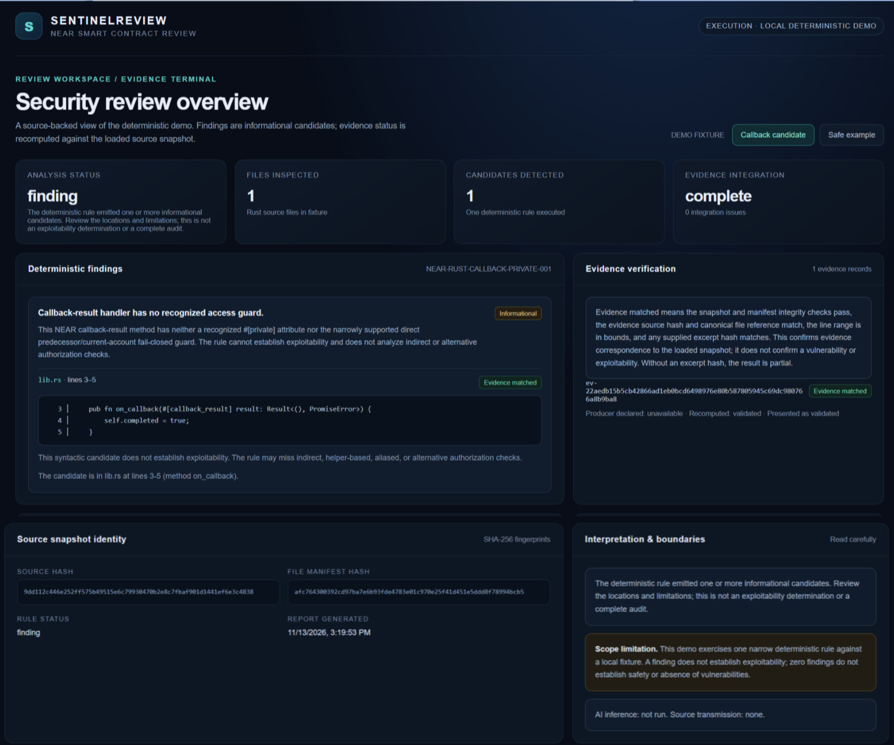
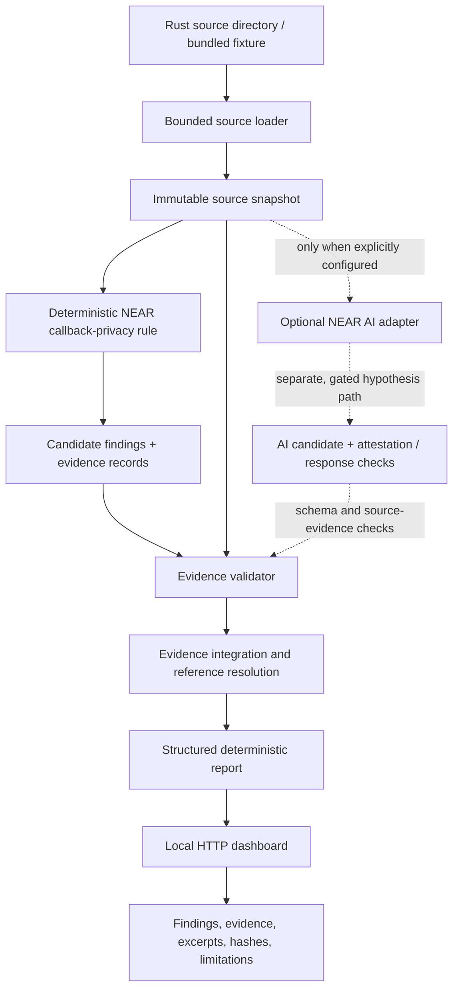
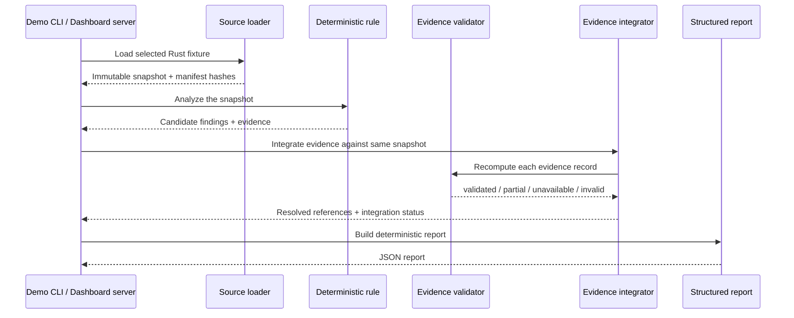

# Sentinel Review

<p align="center">
  
</p>

<p align="center">
  <a href="#quick-start-and-step-by-step-testing">
    
  </a>
  &nbsp;&nbsp;
  <a href="./LICENSE">
    
  </a>
  &nbsp;&nbsp;
  <a href="https://github.com/chokri29/SentinelReview/actions/workflows/ci.yml">
    
  </a>
</p>

<p align="center">
  <strong>A deterministic evidence-verification foundation for NEAR Rust smart-contract review.</strong><br>
  Local source analysis · Reproducible evidence · Explicit trust boundaries
</p>

> **Project status:** early-stage research and hackathon prototype. SentinelReview supports investigation and human review. It is not a complete security audit, an exploitability oracle, or a contract safety certification.

## At a glance

SentinelReview loads a bounded Rust source snapshot, runs a narrow deterministic NEAR callback-privacy rule, recomputes evidence against that exact snapshot, and produces a structured report. A local dashboard presents the report without changing the analysis.

| Capability | What it does | What it does not claim |
|---|---|---|
| Bounded source ingestion | Loads `.rs` files, rejects unsafe filesystem conditions, and creates immutable snapshot data and SHA-256 manifest fingerprints | Does not establish who authored the source or prove its provenance |
| Deterministic rule | Checks one narrowly scoped NEAR Rust callback-result privacy pattern | Does not perform a complete Rust, NEAR, dependency, or business-logic audit |
| Evidence validation | Recomputes source/manifest identity, file reference, line range, and optional excerpt-hash correspondence | Does not prove a finding is exploitable or that source is safe |
| Evidence integration | Resolves finding references and reports complete, partial, or invalid integration | Does not turn a producer-declared status into trusted evidence |
| Local dashboard | Displays the real structured demo report, source excerpts, hashes, execution metadata, and limitations | Does not run analysis in the browser, call an AI model, upload source, or expose a network service |
| Optional NEAR AI adapter | Provides a separate, gated inference path for hypotheses and verification metadata | Is not used by the deterministic demo or dashboard; no live inference is implied |

## Architecture

### System overview

The central trust boundary is:

**AI may propose hypotheses → deterministic checks and evidence validation decide what is reproducible → people interpret the result.**

The current dashboard exercises only the local deterministic path.



The dotted AI path is separate from the local demo. The dashboard does not invoke it.

### Deterministic review sequence



### Trust boundaries and terminology

| Term | Meaning in this project |
|---|---|
| **Finding / candidate** | A result emitted by the selected rule. It is a review lead, not proof of exploitability. |
| **Evidence matched** | Dashboard wording for a location whose evidence reference is resolved and whose recomputed status is `validated`. It means the evidence corresponds to the loaded snapshot under the validator's checks—not that a vulnerability is confirmed. |
| **Recomputed: validated** | The validator status produced by checking the evidence against the snapshot. The producer's declared status is shown separately. |
| **Partial** | Evidence checks could not establish every required integrity property (for example, an excerpt hash was not supplied). |
| **Complete integration** | Evidence records are validated and finding references resolve uniquely, with no invalid condition. |
| **No candidate detected** | The selected rule emitted no finding for this input. This is **not** a safety certification. |
| **Local deterministic demo** | The server runs the loader and deterministic demo pipeline against a bundled fixture on the same machine. |

The validator checks the evidence schema, snapshot and manifest structure, canonical paths and ordering, snapshot/manifest file consistency, file hashes and metadata, manifest/source hashes, evidence source hash, unique file reference, line bounds, and any supplied excerpt hash. A missing excerpt hash can result in `partial`, not `validated`.

## What the current deterministic rule checks

The current rule ID is `NEAR-RUST-CALLBACK-PRIVATE-001`.

It looks for NEAR Rust callback-result handlers without a recognized `#[private]` attribute or the narrowly supported direct predecessor/current-account guard. A recognized manual guard is reported as inconclusive rather than treated as proof that the guard is effective.

**Coverage is intentionally narrow.** The rule may miss indirect or alternative authorization logic, other vulnerability classes, unsafe cross-contract behavior, dependency risks, and issues outside the inspected Rust source.

## Local dashboard

The dashboard is a local presentation layer over the actual deterministic report.

| Item | Behavior |
|---|---|
| Bind address | `127.0.0.1` only |
| Default port | `4173` (override with `PORT`) |
| `GET /` | Serves `dashboard/index.html` |
| `GET /api/review?fixture=triggering` | Loads the unguarded bundled fixture and returns its deterministic report |
| `GET /api/review?fixture=safe` | Loads the `#[private]` fixture and returns its deterministic report |
| Invalid fixture | HTTP `400` |
| Unknown route | HTTP `404` |
| Non-GET request | HTTP `405` |

The API response includes the selected fixture, report generation time, structured report, source excerpts taken from the same loaded immutable snapshot, and explicit execution metadata:

- `mode: local_deterministic_demo`
- `aiInference: not_run`
- `sourceTransmission: none`

The dashboard renders the rule's actual severity, candidate count, evidence-integration status, evidence declaration versus recomputed status, source excerpts, source and manifest hashes, and interpretation/limitations. A zero-candidate state retains the warning that this is not a safety determination.

The server sends no-store, nosniff, Content Security Policy, and no-referrer headers. It uses Node's built-in HTTP and filesystem modules; no separate web framework or hosted dashboard service is required.

## Quick start and step-by-step testing

### 1. Prerequisites

- Node.js **24.22.1 or newer** (CI currently uses Node.js 24.22.2).
- npm (included with Node.js).
- Git.

Check your installed versions:

```bash
node --version
npm --version
```

### 2. Get the project and install locked dependencies

```bash
git clone https://github.com/chokri29/SentinelReview.git
cd SentinelReview
npm ci
```

Use `npm ci` so the dependency tree is installed from the committed lockfile.

### 3. Run static type checking

```bash
npm run typecheck
```

Expected result: TypeScript completes with no type errors.

### 4. Run the automated test suite

```bash
npm test
```

Expected result: Vitest completes successfully. The suite includes source-loader, deterministic-rule, evidence-validation/integration, AI-adapter policy/verification, and dashboard HTTP smoke tests. The dashboard smoke test starts the real local server on an ephemeral port and exercises both fixture routes, response metadata, evidence excerpts, invalid fixture handling, unknown routes, and rejected HTTP methods.

### 5. Run the triggering deterministic fixture

```bash
npm run demo:deterministic
```

Expected behavior:
- Loads `demo-fixtures/callback-unguarded/lib.rs`.
- Runs the one deterministic callback-privacy rule.
- Emits an informational candidate for the fixture.
- Prints a structured JSON report with snapshot fingerprints, rule status, evidence integration, findings, and limitations.

### 6. Run the safe example fixture

```bash
npm run demo:deterministic -- safe
```

Expected behavior:
- Loads `demo-fixtures/callback-safe/lib.rs`, which uses `#[private]`.
- The selected rule emits no finding for this fixture.
- The report still does **not** certify the source as safe or vulnerability-free.

### 7. Start and inspect the dashboard

```bash
npm run dashboard
```

Open **http://127.0.0.1:4173** in a browser on the same machine.

1. The page loads the **Callback candidate** fixture by default.
2. Inspect the candidate, its informational severity, source location, and source excerpt.
3. Inspect the evidence panel. Compare **Producer declared** with **Recomputed**; these are deliberately separate.
4. Read the **Evidence matched** explanation. It describes evidence correspondence to the loaded snapshot, not vulnerability confirmation.
5. Switch to **Safe example**. Confirm that no candidate is displayed and that the safety limitation remains visible.
6. Inspect the source and manifest SHA-256 fingerprints and the local/no-AI execution disclosure.
7. Stop the server with `Ctrl+C`.

To use a different port on macOS/Linux:

```bash
PORT=4174 npm run dashboard
```

PowerShell:

```powershell
$env:PORT = "4174"
npm run dashboard
```

The dashboard is intentionally local-only. It is not a static hosted site, GitHub Pages app, or remote review service. The browser requests the local server, and the local server runs the deterministic pipeline.

### 8. Run the same checks as CI

The GitHub Actions workflow runs on pull requests targeting `main` and pushes to `main`. It performs:

1. `npm ci`
2. `npm run typecheck`
3. `npm test`
4. `npm run demo:deterministic`
5. `npm run demo:deterministic -- safe`

CI does not perform live NEAR AI inference or run the controlled canary.

## Source layout

| Path | Responsibility |
|---|---|
| `src/contracts/v1.ts` | Versioned Zod schemas and shared report/evidence contracts |
| `src/source/load-source.ts` | Bounded Rust source loading, immutable snapshot, manifest creation |
| `src/source/manifest-hash.ts` | Domain-separated SHA-256 manifest/source hashing |
| `src/rules/parse-rust.ts` | Rust syntax parsing support for the deterministic rule |
| `src/rules/near-rust-callback-private.ts` | The narrow NEAR callback-result privacy rule |
| `src/source/validate-evidence.ts` | Deterministic evidence integrity validation |
| `src/source/integrate-evidence.ts` | Evidence validation, duplicate detection, and finding-reference resolution |
| `src/demo/deterministic-review.ts` | Builds the structured deterministic demo report |
| `scripts/demo-deterministic-review.ts` | CLI entry point for the two deterministic fixtures |
| `scripts/dashboard-server.ts` | Local HTTP server and fixture-backed report API |
| `dashboard/index.html` | Dashboard presentation; consumes the local report API |
| `src/ai/near-ai-adapter.ts` | Separate optional NEAR AI inference adapter and verification policy |
| `scripts/near-ai-attestation-discovery.ts` | Attestation and runtime-measurement discovery utility |
| `scripts/near-ai-controlled-canary.ts` | Conditional synthetic-prompt canary entry point |
| `tests/` | Unit, contract, integration, and dashboard HTTP smoke tests |
| `demo-fixtures/` | Bundled triggering and safe Rust examples |

## Source-ingestion limits

The loader applies bounded traversal defaults:

| Limit | Default |
|---|---:|
| Rust files | 200 |
| Bytes per file | 1 MiB |
| Total source bytes | 5 MiB |
| Directory entries examined (including directories and non-Rust files) | 2,000 |
| Directory depth (source root = depth 0) | 32 |

These limits can be overridden through the loader options when used as a library. Exceeding an entry or depth limit fails the load; no partial snapshot is returned.

When loading a contract for review, point the loader at the contract's Rust source directory (the directory containing the relevant `.rs` files), not the repository or workspace root. This avoids spending the bounded entry budget on unrelated files, build output, or dependencies.

## Optional NEAR AI inference (separate from the demo)

Live inference is separate from the local deterministic demo. The demo commands and dashboard do not require credentials and make no provider request. `src/ai/near-ai-adapter.ts` is an implementation interface, not a package-level live-review command.

When inference is explicitly enabled by an integrating application, the adapter sends the complete loaded Rust-source snapshot (each file's path and contents) together with deterministic-finding metadata to the configured NEAR AI model. It sends neither source nor findings if the complete source exceeds 256 KiB or the serialized prompt exceeds 320 KiB; it does not truncate either to fit. Inference also requires a configured `NEARAI_API_KEY` and explicit operator-approved model deployment measurements. With no approved measurements, inference is not run. Supply the API key through the runtime environment or application configuration, never commit it.

The client configures the NEAR AI SDK with `e2ee: true` and Ed25519 signing, and validates attestation and response-verification results before accepting AI findings. These implementation details do not establish provider retention practices, absolute confidentiality, or guarantees about data handling; consult current provider documentation and your organization's policies before sending source to a service. No live inference result is asserted by this repository's local demo.

### Attestation and deployment measurements

The inference adapter checks the SDK-verified gateway/model attestation against its configured policy, requires an `UpToDate` TCB status, required GPU evidence, verified model deployment provenance, and runtime Compose/OS-image measurements matching the operator-supplied approved measurements. It also requires a usable model Ed25519 key before inference.

After inference, it requires a verified response ID matching the completion ID and a `provider_tee` response signature associated with approved model-attestation evidence before accepting candidates.

These are checks and measurements observed or enforced by the implementation; they are not an independent security review or independent NEAR approval. The separate `scripts/near-ai-attestation-discovery.ts` utility reports gateway/model TCB and GPU verification results, runtime Compose and OS-image hashes, and a bounded Compose image inventory. Discovery explicitly reports `deploymentProvenance: "not_checked"` and `measurementApproval: "not_approved"`. A parsed Compose file is configuration data, not proof that those images were deployed or approved.

### Controlled canary

The controlled canary in `scripts/near-ai-controlled-canary.ts` is conditional and is not part of the local demo or CI. It requires `NEARAI_API_KEY` plus operator-supplied values for:

- `NEARAI_OPERATOR_APPROVED_MODEL_ID`
- `NEARAI_OPERATOR_APPROVED_COMPOSE_HASH`
- `NEARAI_OPERATOR_APPROVED_OS_IMAGE_HASH`

The model value must match the canary's fixed model, and the supplied hashes must match the runtime measurements returned by attestation. The canary then checks the configured TCB/GPU and gateway TLS-attestation policies, sends only its fixed synthetic prompt, and verifies the response ID and provider TEE signature. The values are an operator-controlled allowlist, not independent NEAR approval; its report preserves `independentNearApproval: "not_established"`.

These prerequisites describe how it can be run; they do not mean a live canary has been performed successfully. Do not run live inference or the canary unless the operator intentionally configures and approves the target deployment and understands what data is sent.

## Security limitations and interpretation

- The deterministic rule set is limited and is not a complete audit.
- A finding, whether deterministic or AI-generated, does not by itself establish exploitability.
- Absence of findings does not establish safety or absence of vulnerabilities.
- Evidence validation checks correspondence to the supplied snapshot; a matching hash is not independent provenance or source authenticity.
- The dashboard's **Evidence matched** label describes evidence integrity only.
- Attestation, signature, TCB, GPU, and measurement checks establish only the properties they check. They do not prove analysis correctness, completeness, provider retention behavior, or independent approval.
- Treat incomplete, failed, unavailable, inconclusive, and not-run states as limitations, not as passing results.

SentinelReview is an evolving foundation. Interpret its reports and measurements alongside source review, tests, and an appropriately scoped independent security assessment.
